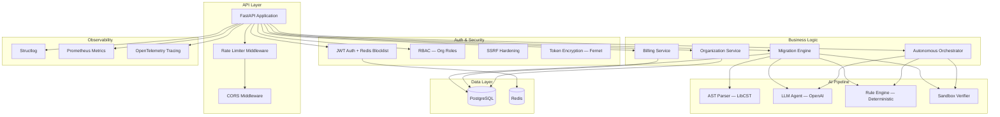
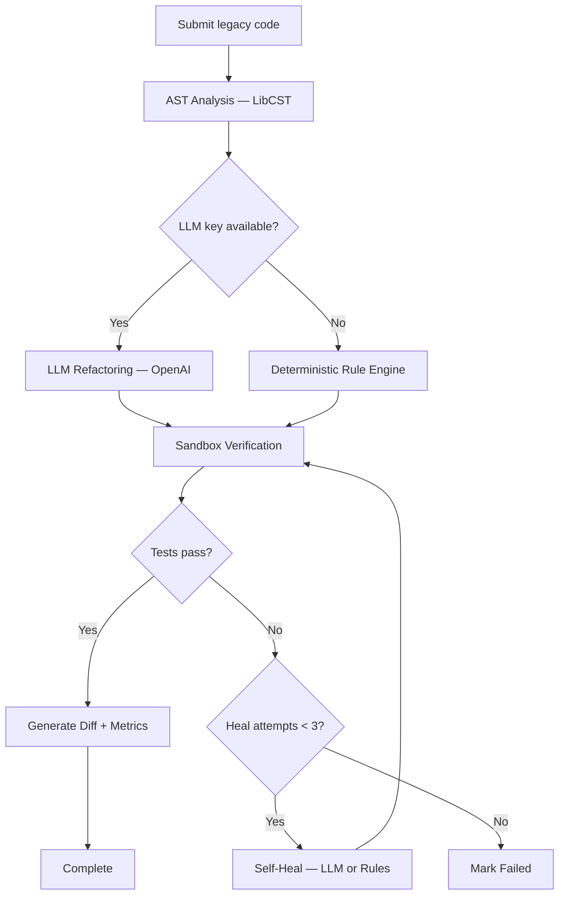
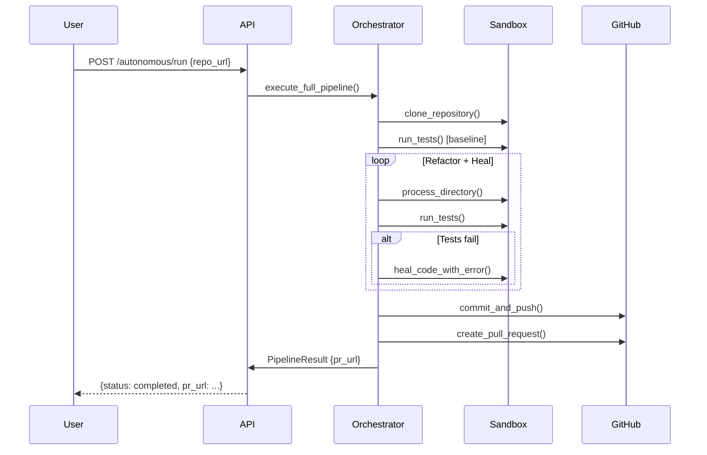
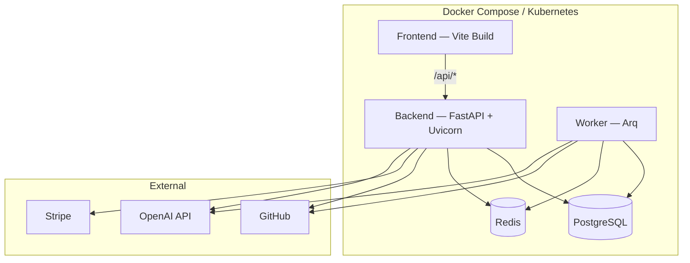

# Architecture

## System Overview

```mermaid
C4Context
    title OmniMigrate — System Architecture

    Person(user, "Engineer", "Submits legacy code for migration")
    Person(admin, "Admin", "Manages org, users, billing")

    System(omnimigrate, "OmniMigrate", "AI-powered legacy code migration engine")

    System_Ext(github, "GitHub", "Source code repositories")
    System_Ext(stripe, "Stripe", "Payment processing")
    System__ext(openai, "OpenAI", "LLM refactoring provider")
    System_Ext(otel, "OTel Collector", "Traces & metrics export")

    Rel(user, omnimigrate, "Submits code, reviews PRs")
    Rel(admin, omnimigrate, "Manages users, views billing")
    Rel(omnimigrate, github, "Clones repos, pushes branches, opens PRs")
    Rel(omnimigrate, stripe, "Creates checkout sessions, webhooks")
    Rel(omnimigrate, openai, "Code refactoring & self-healing")
    Rel(omnimigrate, otel, "Exports traces & metrics")
```

## Backend Layer Architecture



## Migration Pipeline Flow



## Autonomous Git Pipeline



## Deployment Architecture


